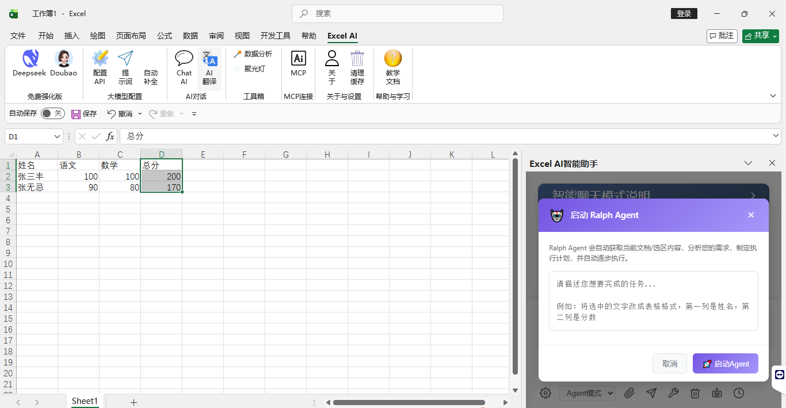
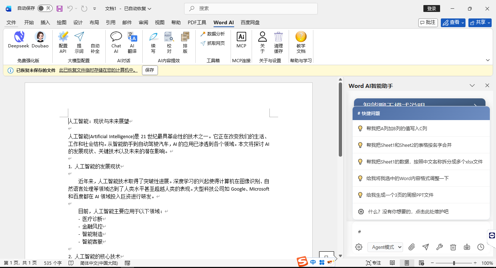
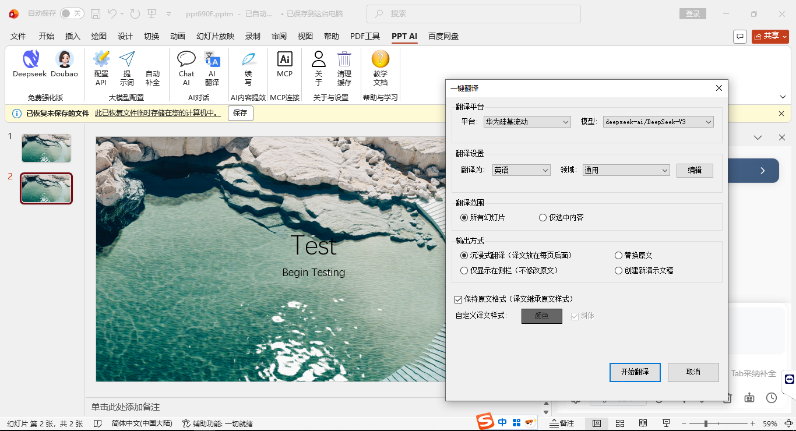
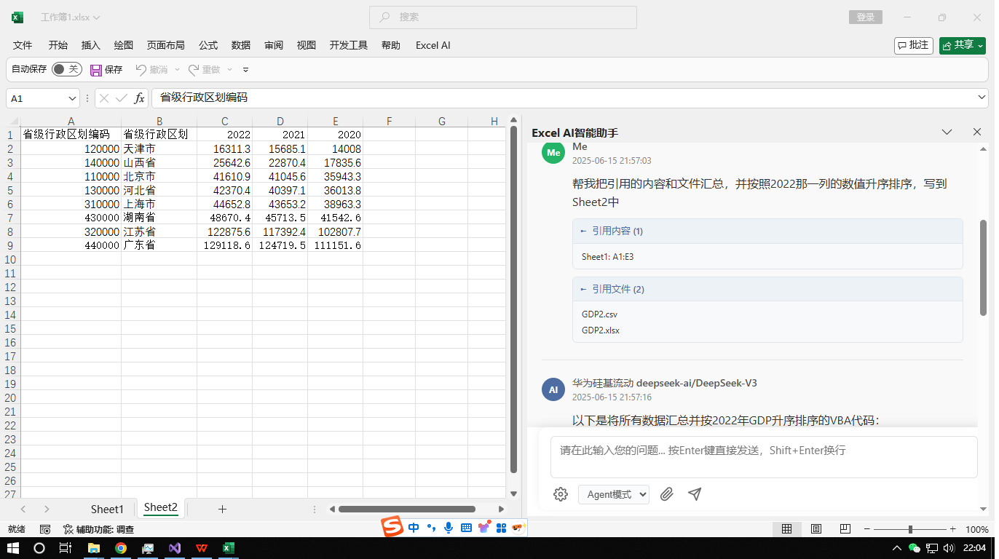
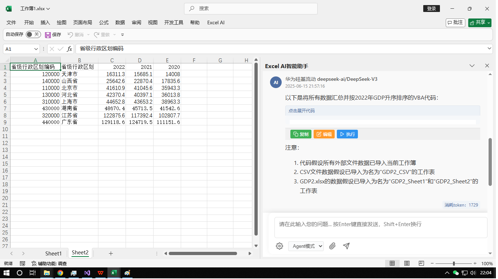
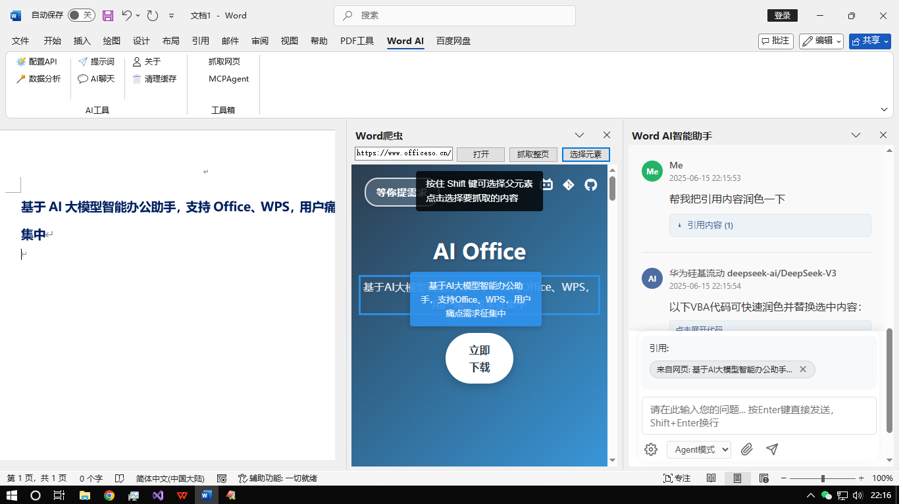
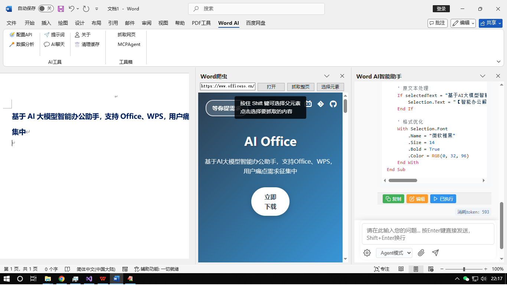

# Office AI 智能体

<div align="center">

[](LICENSE)
[](https://www.microsoft.com/windows)
[](https://www.microsoft.com/office)

**🌐 Language / 语言选择**

[English](README_EN.md) | [中文](README.md)

</div>


> **注意**: 本项目90%以上代码基于Cursor + Copilot + Qoder + Claude编程工具开发
>
> 帮助文档官网：https://www.officeso.cn
>
> 源码本地运行教程：https://www.bilibili.com/cheese/play/ep2098181
>
> Excel/Word/PPT插件三合一部署打包教程：https://www.bilibili.com/cheese/play/ep2098188


## 预览







## 📖 目录

- [概述](#概述)
- [功能特性](#功能特性)
- [AI Native 架构](#ai-native-架构)
- [支持产品](#支持产品)
- [功能展示](#功能展示)
- [安装说明](#安装说明)
- [使用说明](#使用说明)
- [开发相关](#开发相关)
- [贡献指南](#贡献指南)
- [开源协议](#开源协议)

---

## 概述

办公AI智能体是基于 **Visual Studio Community 2022/2026 + Visual Basic.NET + VSTO + WebView2** 开发的 AI Native Office 插件。它为 Excel、Word、PowerPoint 提供聊天式任务窗格、文档上下文读取、智能排版校对、数据分析、内容生成、MCP/Skills 扩展等能力，让用户可以直接用自然语言驱动当前打开的 Office 文件。

### 🎯 项目目标

- **智能办公自动化**: 为日常办公任务提供AI驱动的辅助
- **多平台支持**: 兼容Microsoft Office和WPS
- **用户友好界面**: 简单直观的操作
- **持续改进**: 定期更新和功能增强

---

## 功能特性

### ✨ 核心功能

- **AI Native Chat**: 在 Office 右侧任务窗格中直接对当前文档、选区、表格或幻灯片提需求。
- **Word 智能排版**: 支持自然语言排版、标题/序号重构、自动编号整理、样式统一、预览和执行反馈。
- **Word 校对审阅**: 面向错别字、标点、病句、正式文档表达进行校对建议，减少无意义遮挡式提示。
- **Excel 数据分析**: 支持选区/工作表上下文读取、数据问答、整理分析、图表和公式辅助。
- **PowerPoint 内容辅助**: 支持演示文稿内容生成、续写、翻译、排版和审阅。
- **AI 智能翻译**: 支持段落、页面、文档级多语言翻译，可配置不同模型。
- **记忆与上下文**: 支持短期会话上下文、长期记忆检索和当前 Office 文件上下文组合。
- **MCP / Skills 扩展**: 内置 MCP Client，可配置 MCP Server 和 Skills，扩展外部工具能力。
- **Agent Loop**: 面向复杂任务采用 plan -> act -> observe -> repair -> explain 的执行链路，而不是只生成聊天回复。
- **多模型配置**: 支持 DeepSeek、Doubao 等模型接入，并保留可扩展配置入口。

---

## AI Native 架构

项目正在从“聊天式插件”升级为“可执行的 Office Agent”。核心目标是让 AI 能观察当前 Office 文件、规划操作、调用工具、验证结果，并在失败时自动修复。

#### 🎯 核心能力

| 能力 | 状态 | 说明 |
|------|------|------|
| **Harness** | 持续建设 | 把 Office 操作封装成 AI 可调用、可观察、可验证的能力 |
| **Agent Loop** | 持续建设 | 复杂任务进入计划、执行、观察、修复和解释流程 |
| **上下文感知** | 已接入 | 自动读取选区、全文、段落、样式、数据表和会话上下文 |
| **Word Action Harness** | 已接入 | 支持 Word 排版、校对、自动编号等自然语言操作入口 |
| **MCP Client** | 已接入 | 支持连接 MCP Server 扩展工具 |
| **记忆系统** | 已接入 | 支持近期会话和长期记忆检索 |
| **预览/撤销方向** | 持续建设 | 关键写操作优先提供预览、解释和可恢复路径 |

#### ✨ 使用体验目标

**1. Word 能力从聊天走向执行**

```text
用户: "帮我把前面的序号改为12345"
  ↓
Harness 读取当前 Word 文档的段落、编号和范围
  ↓
Numbering Agent 规划并执行自动编号修复
  ↓
Observer 验证编号是否连续并反馈结果
```

**2. 插件自己读取上下文**

```text
用户选中 Word 中几段内容
用户: "给我重构序号和标题"

AI 不应反复询问全文/选区/编号格式，而是先读取选区和段落结构，给出可执行计划或预览。
```

**3. Excel 数据理解**

```text
用户选中 A1:B100 销售数据
AI 自动知道:
- 选区: A1:B100
- 数据类型: 表格(含表头)
- 列名: 销售员, 销售额
- 前3行预览

用户: "算提成"
AI: 知道在 B 列计算，不需要再问
```

#### 🔍 技术亮点

- **Harness 原子工具架构**: 把 `ListParagraphs`、`GetParagraphInfo`、`SetParagraphFormat` 等 Office 操作暴露为可组合能力。
- **Planner / Agent**: 面向用户目标生成结构化计划，而不是把自然语言直接变成聊天回复。
- **Observer / Repair**: 执行后读取真实 Office 状态，失败时基于观察结果修复计划。
- **Capability / Skill**: 新能力以可发现、可解释、可测试的能力单元接入。

#### 📖 相关文档

- [Visual Studio 2026 打开 OfficeAgent.vdproj 失败处理](docs/VS2026-InstallerProjects.md)

---

## 支持产品

| 产品 | 状态 | 功能 |
|------|------|------|
| **Microsoft Excel** | ✅ 支持 | 数据分析、图表生成、公式辅助、ALLM/CLLM 函数、选区问答 |
| **Microsoft Word** | ✅ 支持 | 文档处理、内容生成/补全、校对、续写、排版、标题/序号重构、智能翻译 |
| **Microsoft PowerPoint** | ✅ 支持 | 演示文稿创建、幻灯片设计、审阅、续写、排版、智能翻译 |
| **WPS Office** | ✅ 兼容 | 与WPS套件完全兼容 |

---

## 功能展示

### Excel示例

可引用选择的Sheet或单元格、以及外部Excel文件进行分析问答并整理数据。





### Word示例

引用外部网站的数据分析，并将结果插入Word文档中。





---

## 安装说明

### 系统要求

- **操作系统**: Windows 10/11
- **办公套件**: Microsoft Office 2016+ 或 WPS Office
- **运行时**: .NET Framework 4.7.2+、Microsoft Edge WebView2 Runtime、VSTO Runtime
- **开发环境**: Visual Studio Community 2022/2026 + VSTO 工作负载
- **安装包构建**: `OfficeAgent/OfficeAgent.vdproj` 需要当前 Visual Studio 实例安装 `Microsoft Visual Studio Installer Projects` 扩展

### 用户安装

1. 关闭正在运行的 Word、Excel、PowerPoint 和 WPS。
2. 从官网或发布页下载 `OfficeAgent.msi`。
3. 双击运行安装包；如果企业策略限制写入 Office 插件注册表，请使用管理员身份运行。
4. 安装完成后打开 Word、Excel 或 PowerPoint。
5. 在功能区找到 AI 助手入口，首次使用时配置模型、API Key、MCP/Skills 等选项。
6. 如果 Office 提示加载项被禁用，在 Office 的 `文件 -> 选项 -> 加载项` 中重新启用对应插件。

### 📦 下载安装包

- **官方下载**: [https://www.officeso.cn/](https://www.officeso.cn/)
- **最新版本**: 获取最新的稳定版本
- **简易安装**: Windows一键安装程序

### 从源码构建和调试

```bash
# 还原依赖
msbuild AiHelper.sln -t:Restore

# 推荐：只构建四个代码项目（不含安装包 vdproj）
.\build-code.bat
# 或
powershell -File .\scripts\build-code-projects.ps1 -Configuration Debug

# 打 MSI 前准备（Release 代码 + SourcePath 审计，不生成 MSI）
.\build-installer-prep.bat
```

**不要**用整解决方案 Debug Rebuild 判断代码是否可编：`OfficeAgent.vdproj` 的 SourcePath 指向 `bin\Release`，安装项目失败常被误判为代码编译失败。完整说明见下文「从源码构建」与 [docs/VS2026-InstallerProjects.md](docs/VS2026-InstallerProjects.md)。

调试 VSTO 插件时，建议用 Visual Studio 启动对应 Office 宿主进程。Debug 构建通常用于开发调试；生产分发建议使用 Release 构建并通过 MSI 安装。

### Visual Studio 2026 打不开 OfficeAgent.vdproj

如果 VS 2026 提示 `OfficeAgent.vdproj` 不兼容，并出现 `54435603-dbb4-11d2-8724-00a0c9a8b90c`，原因通常不是 VB.NET 项目版本过低，而是当前 VS 实例缺少 `.vdproj` 项目类型支持。

处理方式：

1. 在 VS 2026 安装并启用 [Microsoft Visual Studio Installer Projects](https://marketplace.visualstudio.com/items?itemName=VisualStudioClient.MicrosoftVisualStudio2022InstallerProjects) 扩展。
2. 重启 Visual Studio 后重新打开 `AiHelper.sln`。
3. 如果扩展短期不可用，可以先构建/调试 `ShareRibbon`、`WordAi`、`ExcelAi`、`PowerPointAi`，再用支持该扩展的 Visual Studio 实例构建 MSI。
4. 详细说明见 [Visual Studio 2026 打开 OfficeAgent.vdproj 失败处理](docs/VS2026-InstallerProjects.md)。

### Excel XLL 数字签名提示

Debug 环境下 `ExcelAi-AddIn64.xll` 可能提示没有可用的数字签名。开发阶段可通过 Office 信任位置、启用加载项或内部安装路径解决；公开分发时再考虑代码签名。没有付费证书不影响本地开发和功能验证。

### VSTO 开发证书与发布签名

- **开发**：各插件使用本地 `*_TemporaryKey.pfx` 签 VSTO 清单。克隆仓库后若签名失败，运行：
  `powershell -File .\scripts\ensure-vsto-temp-keys.ps1`
- **禁止**将 `*.pfx` / `*.snk` / 正式签名私钥提交到 Git。
- **发布**：使用 `build/SignArtifacts.ps1` 与环境变量 `OFFICE_AI_SIGN_CERT_THUMBPRINT` 或 `OFFICE_AI_SIGN_PFX`，不要用 TemporaryKey 签对外 MSI。
- 发布签名的参数与证书来源见 [build/SignArtifacts.ps1](build/SignArtifacts.ps1)；开发证书生成见 [scripts/ensure-vsto-temp-keys.ps1](scripts/ensure-vsto-temp-keys.ps1)。

---

## 使用说明

### 快速开始

1. **启动Office应用程序**: 打开Excel、Word或PowerPoint
2. **访问AI助手**: 在功能区找到AI助手选项卡
3. **配置模型**: 在设置中填写 API Key、模型地址和偏好配置
4. **引用上下文**: 选中文档内容、表格区域或幻灯片后直接输入需求
5. **执行任务**: AI 会根据当前文件上下文进行分析、生成、排版、校对或解释

### Word 常用说法

- `给我重构序号和标题`
- `帮我把前面的序号改为12345`
- `把全文字体统一加大2号`
- `校对全文，只修明显错别字和标点`
- `把选中的内容改成正式报告风格`

### Excel 常用说法

- `分析选中区域的数据异常`
- `根据这张表生成一段经营分析`
- `帮我生成适合当前数据的图表`
- `给这一列补充公式并解释`

### PowerPoint 常用说法

- `根据当前主题生成一页总结页`
- `优化选中幻灯片的表达`
- `把这页改成汇报风格`
- `检查整份 PPT 的错别字和表达问题`

### 高级功能

- **MCP/Skills**: 连接外部工具、知识库或企业系统。
- **记忆**: 结合近期会话和长期记忆减少重复说明。
- **执行解释**: 对关键写操作展示准备修改什么、已经修改什么、是否需要确认。
- **预览优先**: 排版、校对等高影响操作优先走预览/执行反馈链路。

---

## 开发相关

### 开发环境

- **开发工具**: Visual Studio Community 2022/2026
- **编程语言**: Visual Basic.NET
- **框架**: VSTO (Visual Studio Tools for Office)
- **版本控制**: Git

### 项目结构

```
AiHelper/
├── ExcelAi/          # Excel插件
├── WordAi/           # Word插件
├── PowerPointAi/     # PowerPoint插件
├── ShareRibbon/      # 共享组件
├── OfficeAgent/      # 安装程序
├── docs/             # 调试和安装说明
└── openspec/         # 需求和设计规格
```

### 从源码构建

```bash
# 克隆仓库
git clone https://github.com/it235/office-ai-agent.git

# 还原依赖
msbuild AiHelper.sln -t:Restore

# 构建代码项目（推荐）
.\build-code.bat
```

构建安装包前：先 `.\build-installer-prep.bat`，再确认 Visual Studio 已安装 `Microsoft Visual Studio Installer Projects` 扩展并 Build `OfficeAgent.vdproj`。详见 [docs/VS2026-InstallerProjects.md](docs/VS2026-InstallerProjects.md)。

---

## 贡献指南

我们欢迎社区贡献！以下是您可以提供帮助的方式：

### 🤝 如何贡献

1. **Fork仓库**: 创建项目的个人分支
2. **创建分支**: 在新分支中进行更改
3. **进行修改**: 实现您的功能或修复
4. **充分测试**: 确保您的更改正确工作
5. **提交PR**: 创建包含详细描述的拉取请求

### 📋 贡献指南

- **代码风格**: 遵循现有代码约定
- **文档**: 为新功能更新文档
- **测试**: 为新功能包含测试
- **沟通**: 在issues中先讨论重大更改

---

## 开源协议

本项目采用Apache 2.0许可证 - 详情请参阅 [LICENSE](LICENSE) 文件。

---

## 📞 联系与支持

### 🌐 官方网站
- **网站**: https://www.officeso.cn/
- **课程**: [OfficeAI办公智能体开发(基于vb.net)](https://www.bilibili.com/cheese/play/ep1540657)

### 📅 更新计划
- **发布周期**: 每2周一个版本
- **关注我们**: 及时获取最新发布信息

### 💬 社区
- **问题反馈**: 报告bug和请求功能
- **讨论**: 分享想法和提问
- **贡献**: 帮助改进项目

---

## 🙏 致谢

特别感谢：

- **DeepSeek**: 提供优秀的AI模型
- **Microsoft**: 提供VSTO框架和Office API
- **开源社区**: 提供灵感和支持
- **Cursor & Copilot**: 提供AI驱动的开发辅助

---

<div align="center">

**为Office社区用心制作**

[](https://github.com/it235/office-ai-agent)
[](https://github.com/it235/office-ai-agent)

</div>

